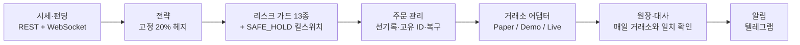

# BTC Inventory Hedge Quant

   

비트코인을 **팔지 않고**, 바이낸스 COIN-M 인버스 무기한 선물(BTCUSD_PERP) 숏으로 **USD 낙폭을 줄이는** 헤지 시스템입니다.
연구(백테스트·통계 검정) → 실행 엔진 → 무인 운영까지 한 저장소에 담았고, 성과는 언제나 **BTC 수량**과 **USD 가치·최대 낙폭** 두 축으로 함께 평가합니다.

*A BTC inventory-hedge research and execution system: COIN-M inverse perpetual shorts that cut USD drawdown without selling BTC — pre-registered research (no timing edge found), risk-guarded execution, unattended paper/demo operation.*

## 한눈에 보기

| | |
|---|---|
| **문제** | BTC 장기 보유는 가격 변동을 그대로 떠안는다. 백테스트 구간(2021.03–2026.09) HODL 의 USD 최대 낙폭 **−76.7%** |
| **방법** | 보유 BTC 를 증거금으로 BTCUSD_PERP 를 고정 USD 명목만큼 숏 → USD 노출이 (1 − 헤지비율)배로 줄고, 숏이 받는 펀딩비가 BTC 로 쌓인다 |
| **연구 결론** | 사전 등록 연구 4라운드 모두 **"타이밍 엣지 없음"**. 최적 정적 비율도 없음. 남는 효과는 낙폭 축소와 펀딩 캐리(20% 기준 연 약 1.1%) |
| **채택** | **20% 고정 헤지** — 수익 극대화가 아니라 시작 시점 의존성이 가장 낮아서(최종 BTC 최고/최악 1.69배, 85% 헤지는 9.91배) |
| **운영** | 2026-09 부터 macOS 데몬으로 무인 운영 — Shadow(실시세·실펀딩 위 가상 1 BTC) + Testnet(바이낸스 데모 계좌, 실제 서명 API) |
| **운영 결과** | 페이퍼 09-11 → 11-12: BTC **−4.3%** 동안 포트폴리오 **−3.2%**, BTC 보유량 **+1.1%**, HODL 대비 **+$826**, 최대 낙폭 −12.1%(HODL −14.9%) |
| **한계** | 폭락 표본이 1~2건이라 방어 효과의 기대값은 통계로 검증할 수 없다. 실계좌 수수료·체결 미검증. 수익을 보장하지 않는다 |

## 1. 헤지 구조

인버스 계약은 1계약 = 100 USD 이고 증거금과 손익이 BTC 로 정산된다. 보유 자산 $E_0$ (USD) 에 대해 명목 $N = h \cdot E_0$ 만큼 숏을 잡으면, 가격이 $P_0 \to P$ 로 움직일 때

$$V(P) = E_0 \left[ (1-h)\,\frac{P}{P_0} + h \right]$$

즉 USD 노출이 $(1-h)$ 배로 **선형으로** 줄어든다($h = 20\%$ → 0.8배). 같은 움직임에서 BTC 수량은 하락장에서 늘고 상승장에서 준다 — 헤지의 비용은 상승분을 덜 가져가는 것이다. 숏은 펀딩비가 양수인 대부분의 기간에 펀딩을 받는다. 계약 수학(손익·평균가·수수료·펀딩·청산)은 [docs/inverse_math.md](docs/inverse_math.md).

실운영에서 확인: 10-18 이후 BTC −9.06% 동안 포트폴리오 −7.21% — 설계한 0.8배 그대로.

## 2. 연구 결과 (2021-03-10 → 2026-09-01, 실데이터, 비용·펀딩 반영)

| 전략 | 최종 BTC | USD CAGR | USD MDD | 거래 | 판정 |
|---|---|---|---|---|---|
| HODL | 1.000 | +6.4% | −76.7% | 0 | 기준 |
| 고정 50% 숏 | 1.246 | +10.8% | −48.7% | 11 | PASS |
| 고정 100% 숏 | 1.172 | +9.6% | −4.3% | 9 | PASS |
| EMA200 단순 | 1.071 | +7.8% | −50.6% | 165 | PASS |
| 동적 헤지 V1 | 1.109 | +8.5% | −47.1% | 243 | PASS(전기간) / **검증구간 FAIL** |

정적 헤지가 HODL 보다 나아 보이는 전체 기간 성적은 2022년 폭락 한 번과 펀딩 수취에 크게 의존한다(V3). 그래서 아래 다섯 라운드는 "어떤 효과가 우연이 아닌가" 를 묻는 데 집중했다. 판정 기준은 결과를 보기 전에 고정했다.

| 라운드 | 질문 | 결과 | 문서 |
|---|---|---|---|
| V1 | 레짐 기반 동적 헤지에 타이밍 알파가 있나 | 전기간 PASS, **검증 구간 FAIL**. BTC 순증가 0.109 중 펀딩이 0.125 — 타이밍 손익은 수수료를 넘지 못함 | [strategy_spec](docs/strategy_spec.md) §5 |
| V2 | 펀딩 가드를 붙인 동적 레짐 | 정적 헤지보다 모든 축에서 열등 → **기각** | [strategy_v2](docs/strategy_v2.md) |
| V3 | 정적 비율 0~85% 전수 탐색 | **최적 비율 없음**. 낙폭 1%p 를 줄일 때마다 BTC 약 0.33%(180일)를 내는 선형 프론티어 — 알파가 아니라 보험 | [strategy_v3](docs/strategy_v3_static_ratio.md) |
| V4 | 무작위·블록 셔플 대조군, 검정 15개에 Šidák 보정(α = 0.00341) | 보정을 통과한 효과 **0건**. 보고했던 승률의 Wilson 95% 구간이 모두 0.5 를 포함 | [strategy_v4](docs/strategy_v4_control_arms.md) |
| V5 | USDT-M 데이터로 폭락 표본 확장 | 사전 등록 관문 3개 **모두 FAIL** → 본 분석 없이 중단. 표본 한계는 남는다 | [strategy_v5](docs/strategy_v5_sample_extension.md) |

* **정정(2026-09-11)**: V3 의 "강건성 검사를 모두 통과하는 구간 10~20%" 논거는 PASS 조건이 2022년 폭락 한 건의 함수였음이 드러나 **철회**했다. 20% 는 유지하되 근거를 14개 시작일 창 전체에서 결과 편차가 가장 작다는 기준으로 바꿨다 — V3 §10.
* **방법론**: 일봉 2,214개·펀딩 정산 6,640건(2020-08 → 2026-09, 페이지별 SHA-256 manifest). 마감된 봉으로 판단하고 **다음 봉 시가**에 슬리피지·Taker 수수료를 붙여 체결(같은 봉 체결 금지를 테스트로 고정). 60/20/20 분리, 워크포워드 7폴드, 시작일 14개 창 — [docs/backtest_methodology.md](docs/backtest_methodology.md).

## 3. 운영 결과 (페이퍼 트레이딩, 2026-11-12 기준)

Shadow 에이전트: 실시세·실펀딩 위의 가상 계좌 1 BTC, 20% 고정 헤지(154계약 숏). 실주문은 나가지 않는다.

| 구간 | BTC 가격 | 포트폴리오 USD | BTC 보유량 | HODL 대비(누적) |
|---|---|---|---|---|
| 09-11 → 10-18 (상승) | +5.26% | +4.31% | −0.90% | −$735 |
| 10-18 → 11-12 (하락) | −9.06% | −7.21% | +2.04% | +$826 |
| **09-11 → 11-12 (전체)** | **−4.28%** | **−3.21%** | **+1.12%** | **+$826** |

* 최대 낙폭(일별) −12.06% vs HODL −14.93%. 펀딩 수입 +0.00247 BTC(연환산 약 1.5%), 수수료 −0.0001 BTC.
* 상승 구간에는 HODL 에 뒤처지고 하락 구간에는 앞선다 — 연구가 예측한 보험의 모양 그대로다. 61일은 엣지의 증거가 아니다.
* Testnet(바이낸스 데모 계좌 0.01 BTC, 09-20 →): 같은 방향(포트폴리오 −6.9% vs HODL −8.0%). 실제 서명 API·유저 스트림·거래소 id 경로 검증용이다.

## 4. 시스템 구조



* **금액 계산**: 전 구간 `Decimal`. 원장이 진실의 원천이고(거래소 이벤트 1건 = 원장 1행, 거래소 id 로 중복 제거) 지갑 잔고는 그 캐시다. 매일 거래소와 대사한다.
* **리스크 가드 13종**: 시세·캔들 신선도, 시계, 포지션 모드·일치, 헤지 한도, 증거금 여유, 미확인 주문, 주문 거부, 예상 밖 입출금, 계약 사양 변경, 스트림 무음, WebSocket 포지션 교차검증.
* **SAFE_HOLD**: 몇 분 뒤 저절로 풀리는 조건(시계 오차, 끊긴 스트림, 거래소 일시 장애)은 그 사이클만 막고 10분 뒤 재시도하며, 3일 연속일 때만 정지를 래치한다. 해제는 사람만 할 수 있다.
* **주문**: 보내기 전에 DB 에 먼저 기록하고 고유 client order id 로 중복을 막는다. 응답을 잃으면 그 id 로 거래소를 조회해 복구한다.
* **실거래 게이트(전부 필요, 기본 비활성)**: `BIQ_ENABLE_LIVE_TRADING=true` · `live.live_trading_enabled: true` · `--confirm-live` · acknowledgement 3중 일치 · API 키/권한 · 시간 동기화 · 포지션 일치 · 미확인 주문 없음 · 헤지율 한도 · 시세 정상 · 계약사양 검증 · One-way 모드 · 소액 한도.
* **품질**: 테스트 256개(unit · integration · simulation), mypy strict, ruff. 장애는 실패하는 재현 테스트를 먼저 만든 뒤 고쳤다.

```
src/btc_inventory_quant/{config,domain,data,indicators,strategy,backtest,exchange,execution,risk,monitoring,storage,runtime,cli}
```
자세한 설명: [docs/architecture.md](docs/architecture.md)

## 5. 운영 기록 — 무인 운영에서 찾아 고친 것

| 날짜 | 증상 | 원인 → 수정 | 문서 |
|---|---|---|---|
| 09-05 | WebSocket 이 연결된 채 24.8시간 무음, 킬스위치 6일 래치 | 절전 후 죽은 소켓 → 무음 감지·강제 재연결, 회복 가능 조건은 래치하지 않음, 외부 알림. 프로세스 90초 정지 현장 시험에서 20초 안에 자가 복구 | [incident 09-05](docs/incident_2026-09-05_stream_silence.md) |
| 09-14 | 복구 경로 버그 2건, 잠든 사이 그날 판단 유실 | 백오프 중 재시작이 스레드를 죽임·기상 직후 감시자 경합 → 진행 여부로 판단, 판단 재시도 추가 | 같은 문서 §7–9 |
| 09-16 | 펀딩 3건 원장 누락 → 대사 불일치로 4일 정지 | 가상 거래소 id 가 재시작마다 1부터 → 정산 시각 기반 id, 원장 복구 | [incident 09-16](docs/incident_2026-09-16_paper_income_ids.md) |
| 09-27 | 데모 계좌 펀딩이 0건으로 보임 | 데모 income API 는 타입 없는 조회에 빈 배열(문서와 다름) → 타입별 조회 | [API 검증](docs/exchange_api_verification.md) §18 |
| 09-30 | 기상 직후 1.3초 시계 오차로 즉시 정지 · 만료된 listenKey 를 이틀간 붙듦 | 2단 시계 가드·재시도 · 연결마다 키 요청, 거부되면 새 키 | [incident 09-30](docs/incident_2026-09-30_testnet_clock_listenkey.md) |
| 10-10 | 원장과 지갑 0.00000033 BTC 불일치(대사 허용오차 아래) | 조기 반환 경로에서 저장 누락 → income 반영 직후 저장, 원장 먼저 쓰기, 시작 시 원장 기준 재구성 + 알림 | 같은 문서 §7 |
| 10-14 | 00:05 판단에서 +2초 시계 오차(17일 중 4일) | 데모 서버를 기준 시계로 쓰던 것 → 프로덕션 시간 기준으로. 10-16 동시 측정으로 원인은 맥 시계로 확정 | 같은 문서 §8 |

## 6. 설치

**macOS (Apple Silicon / Intel)** — 한 줄 부트스트랩(Python 3.12 확인·설치, venv, 의존성, 데이터 검증, 테스트):
```bash
cd btc-inventory-hedge-quant
bash scripts/setup_macos.sh
source .venv/bin/activate
```
수동 설치:
```bash
brew install python@3.12                                        # 없을 때만
python3.12 -m venv .venv && source .venv/bin/activate
pip install -e ".[dev]"
cp .env.example .env                                            # 키는 .env 에만 (커밋 금지)
python -m pytest -q                                             # 256 tests (unit / integration / simulation)
```
상시 실행(macOS): `bash scripts/install_agent.sh shadow` / `bash scripts/install_agent.sh testnet` — 설정 사전 점검 후 모드별 launchd 에이전트를 설치하고 `caffeinate -s` 로 감싸 절전을 막습니다(`install_shadow_agent.sh` 는 shadow 의 별칭). 텔레그램 알림은 `bash scripts/setup_telegram.sh`.

**Windows (PowerShell)**:
```powershell
py -3.12 -m venv .venv
.\.venv\Scripts\activate
pip install -e ".[dev]"
copy .env.example .env
python -m pytest -q
```

**Linux / Docker**: `python3.12 -m venv .venv && source .venv/bin/activate && pip install -e ".[dev]"` 또는 `docker compose run --rm backtest` / `docker compose up -d shadow`.

## 7. 백테스트 실행

```bash
python -m btc_inventory_quant data --raw-dir data/raw download  # 원본 데이터 받기 (공개 저장소에는 없음 — 아래 '데이터')
python -m btc_inventory_quant data verify                       # 받은 페이지가 manifest 의 SHA-256 과 일치하는지
python -m btc_inventory_quant backtest --config configs/backtest.yaml
```

**데이터** — 연구에 쓴 원본 시장 데이터(`data/raw*/` 의 바이낸스 공개 API 응답: 일봉·마크/인덱스 가격·펀딩 이력)와 그 시계열을 그대로 담은 일부 보고서 CSV 는 비공개 작업 저장소에만 두고 **공개 저장소에는 넣지 않았습니다.** 바이낸스는 자사 과거 데이터셋을 비상업·출처 표시 조건으로 배포하고 있고, 공개 API 응답의 재배포를 명시적으로 허용하는 문구는 찾지 못했기 때문입니다. 대신 `data/raw*/manifest.json` — 연구 당시 스냅샷의 구간·행 수·페이지별 SHA-256 — 을 남겼습니다. `download` 는 받은 시점까지의 데이터로 manifest 를 다시 쓰므로 `git diff` 로 연구 스냅샷과 비교할 수 있습니다. 계약 사양 `data/raw/exchange_info.json` 은 실행에 필요해서 포함합니다.

`reports/<run_id>/` 에 `summary.json`, `backtest_report.md`, `trades.csv`, `daily_equity.csv`, `monthly_returns.csv`, `yearly_returns.csv`, `funding_history.csv`, `fee_history.csv`, `hedge_ratio_history.csv`, `benchmark_comparison.csv`, `drawdown.csv`, `sensitivity.csv`, `charts/*.png` 이 생성됩니다.

과최적화 검증(60/20/20 분리, 제한 그리드, Nested walk-forward, 시작일 의존성):
```bash
python -m btc_inventory_quant research --config configs/backtest.yaml walk-forward
```

옵션은 하위 명령 앞/뒤 어느 쪽에 써도 됩니다(`data --raw-dir X verify` = `data verify --raw-dir X`). 전략 파라미터·리스크 한도·비용은 **설정 파일만** 바꾸면 됩니다(`configs/backtest.yaml`).

## 8. 운영 모드

| 모드 | 명령 | 데이터 | 주문 |
|---|---|---|---|
| backtest | `backtest --config configs/backtest.yaml` | 과거 파일 | 시뮬레이션 |
| shadow | `shadow --config configs/shadow.yaml` | 실시간 공개 REST | 페이퍼 계좌(실주문 불가) |
| testnet | `testnet --config configs/testnet.yaml` | 데모 거래소 | 데모 주문 |
| live | `live --config configs/live.yaml --confirm-live` | 실거래소 | **게이트 통과 시에만** |

운영 명령: `status`, `reconcile`, `verify-funding`, `safe-hold [--release --ack I_ACCEPT_COIN_M_TRADING_RISK]`.

## 9. 문서

| 문서 | 내용 |
|---|---|
| [docs/architecture.md](docs/architecture.md) | 계층·데이터 흐름·모드 |
| [docs/inverse_math.md](docs/inverse_math.md) | Inverse 계약 수학(손익·평균가·수수료·펀딩·청산) |
| [docs/backtest_methodology.md](docs/backtest_methodology.md) | 데이터·체결 타임라인·비용·지표·과최적화 방지 |
| [docs/strategy_spec.md](docs/strategy_spec.md) | V1 규칙·파라미터·검증 결과·정직한 결론 |
| [docs/strategy_v2.md](docs/strategy_v2.md) | V2 펀딩 가드 연구 — 2×2 실험, 손익 귀속 분해, **동적 레짐 기각** 판정 |
| [docs/strategy_v3_static_ratio.md](docs/strategy_v3_static_ratio.md) | V3 정적 비율 프론티어 — **최적 비율 부재** 판정, 보험 구조 해부. §10: 단일 사건 오염 정정과 **시작일 분산 기준**으로의 교체 |
| [docs/strategy_v4_control_arms.md](docs/strategy_v4_control_arms.md) | V4 대조군 검정 — **무작위 대비 유의성 0건**, 승률 주장 철회, 거래비용 아티팩트 해부 |
| [docs/strategy_v5_sample_extension.md](docs/strategy_v5_sample_extension.md) | V5 표본 확장 — 사전 등록 관문(G1~G3) **전부 FAIL**, USDT-M 은 COIN-M 펀딩의 대체물이 아님 |
| [docs/risk_management.md](docs/risk_management.md) | 한도·가드·Fail-safe·Live 게이트 |
| [docs/exchange_api_verification.md](docs/exchange_api_verification.md) | Binance COIN-M 공식 문서 검증(VERIFIED/PARTIAL/UNVERIFIED) |
| [docs/demo_verification_runbook.md](docs/demo_verification_runbook.md) | **Demo 접속 절차 + 펀딩 공식 검증** — 미검증 4건 해소 |
| [docs/operations_runbook.md](docs/operations_runbook.md) | 설치·백테스트·Shadow·Testnet·Live·점검 |
| [docs/incident_response.md](docs/incident_response.md) | SAFE_HOLD 트리거·대응·재시작 복구 |
| [docs/incident_2026-09-05_stream_silence.md](docs/incident_2026-09-05_stream_silence.md) | 인시던트 — 죽은 소켓이 6일간 SAFE_HOLD 를 래치한 경위, 원인 3건, 수정, 현장 검증 |
| [docs/incident_2026-09-16_paper_income_ids.md](docs/incident_2026-09-16_paper_income_ids.md) | 인시던트 — 가상 거래소 id 충돌로 빠진 펀딩, 원장 복구 |
| [docs/incident_2026-09-30_testnet_clock_listenkey.md](docs/incident_2026-09-30_testnet_clock_listenkey.md) | 인시던트 — 시계 가드 래치, 만료된 listenKey, 원장/지갑 분리, 00:05 시계 오차 판정 |
| [docs/requirements_audit.md](docs/requirements_audit.md) | 요구사항 21개 절 → 구현·테스트 추적 매트릭스, 감사 후 보강 내역 |

## 10. 알려진 한계 · 미검증 항목

* **폭락 표본은 1~2건이며 늘릴 수 없다.** COIN-M 계약이 2020-08 상장이라 그 이전 실제 펀딩이 존재하지 않고, USDT-M 프록시는 V5 관문에서 기각됐다. 보험형 전략의 기대가치는 이 데이터로 검증 불가.
* **실계좌 미검증**: 운영 결과는 페이퍼(Shadow)·데모(Testnet) 기준이다. 프로덕션 수수료 등급·유동성·실제 체결은 확인하지 않았다.
* **데모 환경은 `fundingRate` 이력을 제공하지 않고, 데모/프로덕션 요율이 다르다**(2.9배 관측). 공식 문서 미명시(UNVERIFIED). 펀딩 검증은 `--snapshot-rate` 로 동일 환경 요율을 미리 잡아야 한다.
* 펀딩 금액 공식(÷ Mark Price)의 COIN-M 원문은 미발견이나, **2026-09-04 실제 정산과 대조하여 VERIFIED(±8.12% 정밀도)** — [docs/inverse_math.md](docs/inverse_math.md) §6. 거래소가 정산액을 8자리 절삭 보고하므로 소액 포지션에서는 이보다 정밀한 검증이 불가하다.
* 데모 호스트의 `GET /dapi/v1/income` 은 `incomeType` 없이 호출하면 빈 배열을 돌려준다(문서와 다름). 프로덕션 동작은 UNVERIFIED — [docs/exchange_api_verification.md](docs/exchange_api_verification.md) §18.
* 현재 VIP0 수수료율·COIN-M BNB 할인 여부 미확인 → 런타임 `commissionRate` 조회, 백테스트는 보수적 0.05%/0.02%.
* 계약 사양 변경 이력 미반영(현재 사양 고정), 일봉 해상도 근사(펀딩 시각 마크가격), 슬리피지·부분체결은 모델값.
* Docker 이미지 빌드 미검증. `.dockerignore` 로 빌드 컨텍스트에서 `.env`·`.venv`·`state/` 는 제외됨.
* 머신러닝 없음(V1 범위 제외).

## 11. 보안

API 키·시크릿은 `.env` 에만 두고 커밋하지 않습니다(`.env.example` 만 제공). 로그는 API Key·Secret·Signature·인증 헤더·listenKey 를 자동 마스킹합니다. 출금 권한 없는 키와 IP 화이트리스트, 전용 서브계정을 권장합니다.

## 12. 개발 방식 · 라이선스 · 면책

* 설계·구현은 AI 코딩 어시스턴트(Claude)와 함께 진행했고, 커밋 기록에 공동 작성자로 남아 있습니다.
* 코드는 MIT — [LICENSE](LICENSE). 시장 데이터는 이 라이선스의 대상이 아니며 바이낸스 약관을 따릅니다.
* 이 소프트웨어는 연구·교육 목적이며 수익을 보장하지 않습니다. 백테스트 결과는 과거 데이터에 기반하며 미래 성과를 담보하지 않습니다. 실거래의 모든 책임은 사용자에게 있습니다.
