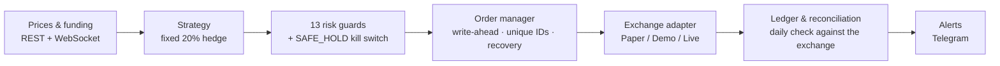

# BTC Inventory Hedge Quant

   

A hedging system that **reduces the USD drawdown of a bitcoin holding without selling it**, by shorting Binance COIN-M inverse perpetual futures (BTCUSD_PERP).
Research (backtests and statistical tests), the execution engine and unattended operation live in one repository, and performance is always judged on two axes at once: **BTC quantity** and **USD value / maximum drawdown**.

## At a glance

| | |
|---|---|
| **Problem** | Holding BTC long term means carrying its full price risk. Over the backtest window (2021-03 → 2026-09), HODL's maximum USD drawdown was **−76.7%** |
| **Method** | Use the BTC holding as margin and short BTCUSD_PERP for a fixed USD notional → USD exposure shrinks to (1 − hedge ratio)×, and the funding the short receives accrues in BTC |
| **Research verdict** | Five research rounds (V1–V5), verdict criteria fixed before the results: **no timing edge**, no optimal static ratio, and the crash sample could not be extended. What remains is drawdown reduction and funding carry (about 1.1% a year at a 20% hedge) |
| **Choice** | **A fixed 20% hedge** — not to maximise return. Across all 14 start-date windows, 10–20% is the band where the final BTC count does not depend heavily on the start date (best/worst 1.26× at 10%, 1.69× at 20%; 9.91× at an 85% hedge), and 20% is the most insurance inside that band |
| **Operation** | Running unattended as macOS daemons since 2026-09 — Shadow (a 1 BTC paper account on live prices and live funding) + Testnet (Binance demo account, real signed API) |
| **Live results** | Paper, 09-11 → 11-12: while BTC moved **−4.3%**, the portfolio moved **−3.2%**; BTC holdings **+1.1%**; **+$826** vs HODL; maximum drawdown −12.1% (HODL −14.9%) |
| **Limits** | With only 1–2 crashes in the sample, the expected value of the protection cannot be tested statistically. Live-account fees and fills are unverified. No profit is guaranteed |

## 1. How the hedge works

One inverse contract is 100 USD, and margin and P&L settle in BTC. Against a holding worth $E_0$ (USD), shorting a notional $N = h \cdot E_0$ means that when the price moves $P_0 \to P$:

$$V(P) = E_0 \left[ (1-h)\,\frac{P}{P_0} + h \right]$$

so USD exposure shrinks **linearly** to $(1-h)$× (0.8× at $h = 20\%$). Over the same moves, the BTC quantity grows in falling markets and shrinks in rising ones — the cost of the hedge is giving up part of the upside. The short collects funding during the long stretches when the funding rate is positive. Contract math (P&L, average price, fees, funding, liquidation): [docs/inverse_math.md](docs/inverse_math.md).

Confirmed in live operation: from 10-18, BTC −9.06% while the portfolio moved −7.21% — the designed 0.8×.

## 2. Research results (2021-03-10 → 2026-09-01, real data, costs and funding included)

| Strategy | Final BTC | USD CAGR | USD MDD | Trades | Verdict |
|---|---|---|---|---|---|
| HODL | 1.000 | +6.4% | −76.7% | 0 | Baseline |
| Fixed 50% short | 1.246 | +10.8% | −48.7% | 11 | PASS |
| Fixed 100% short | 1.172 | +9.6% | −4.3% | 9 | PASS |
| EMA200 simple | 1.071 | +7.8% | −50.6% | 165 | PASS |
| Dynamic hedge V1 | 1.109 | +8.5% | −47.1% | 243 | PASS (full period) / **FAIL (validation)** |

The full-period results that make static hedging look better than HODL depend heavily on a single crash (2022) and on funding received (V3). So the five rounds below ask which effects are not chance. The verdict criteria were fixed before looking at the results.

| Round | Question | Result | Doc |
|---|---|---|---|
| V1 | Does a regime-based dynamic hedge have timing alpha? | PASS over the full period, **FAIL in validation**. Of the 0.109 BTC net gain, funding contributed 0.125 — timing P&L did not cover fees | [strategy_spec](docs/strategy_spec.md) §5 |
| V2 | Dynamic regimes with a funding guard | Worse than a static hedge on every axis → **rejected** | [strategy_v2](docs/strategy_v2.md) |
| V3 | Exhaustive search over static ratios 0–85% | **No optimal ratio**. A linear frontier: each 1 pp of drawdown removed costs about 0.33% of BTC (180 days) — insurance, not alpha | [strategy_v3](docs/strategy_v3_static_ratio.md) |
| V4 | Random and block-shuffle control arms, 15 tests with Šidák correction (α = 0.00341) | **Zero** effects survive the correction. The Wilson 95% interval of every reported win rate contains 0.5 | [strategy_v4](docs/strategy_v4_control_arms.md) |
| V5 | Extend the crash sample with USDT-M data | All three pre-registered gates **FAIL** → stopped without running the main analysis. The sample limit remains | [strategy_v5](docs/strategy_v5_sample_extension.md) |

* **Correction (2026-09-11)**: V3's argument that "10–20% is the band that passes every robustness check" was **withdrawn** once it turned out that the PASS condition was a function of the single 2022 crash. 20% stays, on a rationale that uses all 14 start-date windows instead: it is the top of the 10–20% band where the outcome does not depend heavily on the start date — V3 §10.
* **Methodology**: 2,214 daily candles and 6,640 funding settlements (2020-08 → 2026-09, per-page SHA-256 manifest). Decisions use closed candles and fill at the **next candle's open** with slippage and taker fees (same-candle fills are forbidden by a test). 60/20/20 split, 7-fold walk-forward, 14 start-date windows — [docs/backtest_methodology.md](docs/backtest_methodology.md).

## 3. Live results (paper trading, as of 2026-11-12)

Shadow agent: a 1 BTC paper account on live prices and live funding, fixed 20% hedge (154 contracts short). No real orders are sent.

| Period | BTC price | Portfolio USD | BTC holdings | vs HODL (cumulative) |
|---|---|---|---|---|
| 09-11 → 10-18 (rising) | +5.26% | +4.31% | −0.90% | −$735 |
| 10-18 → 11-12 (falling) | −9.06% | −7.21% | +2.04% | +$826 |
| **09-11 → 11-12 (total)** | **−4.28%** | **−3.21%** | **+1.12%** | **+$826** |

* Maximum drawdown (daily) −12.06% vs HODL −14.93%. Funding income +0.00247 BTC (about 1.5% annualised), fees −0.0001 BTC.
* Behind HODL in the rising stretch, ahead in the falling one — the insurance shape the research predicted. 61 days is not evidence of an edge.
* Testnet (Binance demo account, 0.01 BTC, from 09-20): same direction (portfolio −6.9% vs HODL −8.0%). It exists to exercise the real signed API, user stream and exchange-id paths.

## 4. System architecture



* **Money math**: `Decimal` throughout. The ledger is the source of truth (one exchange event = one ledger row, deduplicated by exchange id) and the wallet balance is its cache. Reconciled against the exchange every day.
* **13 risk guards**: price and candle freshness, clock, position mode and position match, hedge cap, margin buffer, unknown orders, order rejects, unexpected transfers, contract-spec changes, stream silence, WebSocket position cross-check.
* **SAFE_HOLD**: conditions that clear on their own within minutes (clock offset, a dropped stream, a transient exchange outage) block only that cycle and retry 10 minutes later; the halt latches only after 3 consecutive days. Only a human can release it.
* **Orders**: written to the database before they are sent, with a unique client order id to prevent duplicates. If a response is lost, the order is recovered by querying the exchange with that id.
* **Live-trading gate (all required, off by default)**: `BIQ_ENABLE_LIVE_TRADING=true` · `live.live_trading_enabled: true` · `--confirm-live` · acknowledgement matched three ways · API key/permissions · time sync · position match · no unknown orders · hedge-ratio cap · healthy prices · contract-spec check · one-way mode · small-size cap.
* **Quality**: 256 tests (unit · integration · simulation), mypy strict, ruff. Every failure was fixed only after a regression test reproduced it.

```
src/btc_inventory_quant/{config,domain,data,indicators,strategy,backtest,exchange,execution,risk,monitoring,storage,runtime,cli}
```
Details: [docs/architecture.md](docs/architecture.md)

## 5. Operations log — what unattended running found and fixed

| Date | Symptom | Cause → fix | Doc |
|---|---|---|---|
| 09-05 | WebSocket silent for 24.8 hours while still "connected"; kill switch latched for 6 days | Dead socket after laptop sleep → silence detection and forced reconnect, no latching on recoverable conditions, external alerts. In a field test with the process frozen for 90 seconds it recovered on its own within 20 seconds | [incident 09-05](docs/incident_2026-09-05_stream_silence.md) |
| 09-14 | Two bugs in the recovery path; the day's decision lost while asleep | A restart during backoff killed the thread; the supervisor raced the wake → judge streams by progress, add decision retry | Same doc §7–9 |
| 09-16 | 3 funding payments missing from the ledger → reconciliation mismatch, 4-day halt | Paper-exchange ids restarted from 1 on every restart → ids based on settlement time, ledger repaired | [incident 09-16](docs/incident_2026-09-16_paper_income_ids.md) |
| 09-27 | Demo account appeared to receive no funding | The demo income API returns an empty array to untyped queries (differs from the docs) → query per type | [API verification](docs/exchange_api_verification.md) §18 |
| 09-30 | A 1.3 s clock offset right after a wake halted trading at once · an expired listenKey held for two days | Two-tier clock guard with retry · request the key on every connect, fetch a new one if refused | [incident 09-30](docs/incident_2026-09-30_testnet_clock_listenkey.md) |
| 10-10 | Ledger and wallet 0.00000033 BTC apart (below the reconciliation tolerance) | Save missed on an early-return path → save right after income sync, write the ledger first, rebuild from the ledger at startup + alert | Same doc §7 |
| 10-14 | +2 s clock offset at the 00:05 decision (4 of 17 days) | The demo server had been the reference clock → judge against production time. A simultaneous measurement on 10-16 traced it to the Mac's clock | Same doc §8 |

## 6. Installation

**macOS (Apple Silicon / Intel)** — one-line bootstrap (checks/installs Python 3.12, venv, dependencies, data check, tests):
```bash
cd btc-inventory-hedge-quant
bash scripts/setup_macos.sh
source .venv/bin/activate
```
Manual install:
```bash
brew install python@3.12                                        # only if missing
python3.12 -m venv .venv && source .venv/bin/activate
pip install -e ".[dev]"
cp .env.example .env                                            # keys live only in .env (never commit it)
python -m pytest -q                                             # 256 tests (unit / integration / simulation)
```
Always-on (macOS): `bash scripts/install_agent.sh shadow` / `bash scripts/install_agent.sh testnet` — checks the configuration, installs one launchd agent per mode and wraps it in `caffeinate -s` to keep the machine awake (`install_shadow_agent.sh` is an alias for shadow). Telegram alerts: `bash scripts/setup_telegram.sh`.

**Windows (PowerShell)**:
```powershell
py -3.12 -m venv .venv
.\.venv\Scripts\activate
pip install -e ".[dev]"
copy .env.example .env
python -m pytest -q
```

**Linux / Docker**: `python3.12 -m venv .venv && source .venv/bin/activate && pip install -e ".[dev]"` or `docker compose run --rm backtest` / `docker compose up -d shadow`.

## 7. Running a backtest

```bash
python -m btc_inventory_quant data --raw-dir data/raw download  # download the raw data (not in the public repository — see 'Data')
python -m btc_inventory_quant data verify                       # check the downloaded pages against the manifest's SHA-256
python -m btc_inventory_quant backtest --config configs/backtest.yaml
```

**Data** — The raw market data used in the research (Binance public API responses in `data/raw*/`: daily candles, mark/index prices, funding history) and the report CSVs that repeat those series are kept only in the private working repository and **are not included in the public repository.** Binance distributes its historical datasets under non-commercial and attribution terms, and no wording was found that explicitly permits redistributing public API responses. Instead, `data/raw*/manifest.json` — the window, row counts and per-page SHA-256 of the research snapshot — is kept. `download` rewrites the manifest with data up to the time of download, so `git diff` compares it with the research snapshot. The contract specification `data/raw/exchange_info.json` is included because the runtime needs it.

`reports/<run_id>/` receives `summary.json`, `backtest_report.md`, `trades.csv`, `daily_equity.csv`, `monthly_returns.csv`, `yearly_returns.csv`, `funding_history.csv`, `fee_history.csv`, `hedge_ratio_history.csv`, `benchmark_comparison.csv`, `drawdown.csv`, `sensitivity.csv` and `charts/*.png`.

Overfitting checks (60/20/20 split, restricted grid, nested walk-forward, start-date dependence):
```bash
python -m btc_inventory_quant research --config configs/backtest.yaml walk-forward
```

Options can go before or after the subcommand (`data --raw-dir X verify` = `data verify --raw-dir X`). Strategy parameters, risk limits and costs are changed **in the config file only** (`configs/backtest.yaml`).

## 8. Operating modes

| Mode | Command | Data | Orders |
|---|---|---|---|
| backtest | `backtest --config configs/backtest.yaml` | Historical files | Simulated |
| shadow | `shadow --config configs/shadow.yaml` | Live public REST | Paper account (no real orders) |
| testnet | `testnet --config configs/testnet.yaml` | Demo exchange | Demo orders |
| live | `live --config configs/live.yaml --confirm-live` | Live exchange | **Only when the gate passes** |

Operational commands: `status`, `reconcile`, `verify-funding`, `safe-hold [--release --ack I_ACCEPT_COIN_M_TRADING_RISK]`.

## 9. Documentation

| Document | Contents |
|---|---|
| [docs/architecture.md](docs/architecture.md) | Layers, data flow, modes |
| [docs/inverse_math.md](docs/inverse_math.md) | Inverse contract math (P&L, average price, fees, funding, liquidation) |
| [docs/backtest_methodology.md](docs/backtest_methodology.md) | Data, fill timeline, costs, metrics, overfitting safeguards |
| [docs/strategy_spec.md](docs/strategy_spec.md) | V1 rules, parameters, validation results, honest conclusion |
| [docs/strategy_v2.md](docs/strategy_v2.md) | V2 funding-guard study — 2×2 experiment, P&L attribution, **dynamic regimes rejected** |
| [docs/strategy_v3_static_ratio.md](docs/strategy_v3_static_ratio.md) | V3 static-ratio frontier — **no optimal ratio** verdict, anatomy of the insurance structure. §10: correction of single-event contamination and the switch to a **start-date dispersion criterion** |
| [docs/strategy_v4_control_arms.md](docs/strategy_v4_control_arms.md) | V4 control-arm tests — **zero effects significant against random**, win-rate claims withdrawn, transaction-cost artefact dissected |
| [docs/strategy_v5_sample_extension.md](docs/strategy_v5_sample_extension.md) | V5 sample extension — pre-registered gates (G1–G3) **all FAIL**; USDT-M is not a substitute for COIN-M funding |
| [docs/risk_management.md](docs/risk_management.md) | Limits, guards, fail-safes, live gate |
| [docs/exchange_api_verification.md](docs/exchange_api_verification.md) | Verification against the official Binance COIN-M docs (VERIFIED/PARTIAL/UNVERIFIED) |
| [docs/demo_verification_runbook.md](docs/demo_verification_runbook.md) | **Demo access procedure + funding-formula verification** — 4 unverified items resolved |
| [docs/operations_runbook.md](docs/operations_runbook.md) | Install, backtest, Shadow, Testnet, Live, routine checks |
| [docs/incident_response.md](docs/incident_response.md) | SAFE_HOLD triggers, response, restart recovery |
| [docs/incident_2026-09-05_stream_silence.md](docs/incident_2026-09-05_stream_silence.md) | Incident — how a dead socket latched SAFE_HOLD for 6 days, 3 causes, fixes, field verification |
| [docs/incident_2026-09-16_paper_income_ids.md](docs/incident_2026-09-16_paper_income_ids.md) | Incident — funding lost to paper-exchange id collisions, ledger repair |
| [docs/incident_2026-09-30_testnet_clock_listenkey.md](docs/incident_2026-09-30_testnet_clock_listenkey.md) | Incident — clock-guard latch, expired listenKey, ledger/wallet split, verdict on the 00:05 clock offset |
| [docs/requirements_audit.md](docs/requirements_audit.md) | 21 requirement sections → implementation/test traceability matrix, post-audit additions |

## 10. Known limits and unverified items

* **The crash sample is 1–2 events and cannot be enlarged.** The COIN-M contract listed in 2020-08, so no real funding exists before that, and the USDT-M proxy was rejected at the V5 gates. The expected value of an insurance-type strategy cannot be tested with this data.
* **Live account unverified**: operating results are paper (Shadow) and demo (Testnet). Production fee tier, liquidity and real fills have not been checked.
* **The demo environment provides no `fundingRate` history, and demo and production rates differ** (2.9× observed). Not stated in the official docs (UNVERIFIED). Funding verification must capture the same-environment rate in advance with `--snapshot-rate`.
* The COIN-M source text for the funding amount formula (÷ mark price) has not been found, but the formula was **VERIFIED against a real settlement on 2026-09-04 (±8.12% precision)** — [docs/inverse_math.md](docs/inverse_math.md) §6. The exchange reports settlement amounts truncated to 8 decimals, so small positions cannot be verified more precisely.
* The demo host's `GET /dapi/v1/income` returns an empty array when called without `incomeType` (differs from the docs). Production behaviour UNVERIFIED — [docs/exchange_api_verification.md](docs/exchange_api_verification.md) §18.
* Current VIP0 fee rates and the COIN-M BNB discount are unconfirmed → `commissionRate` is queried at runtime; backtests use a conservative 0.05%/0.02%.
* Contract-spec change history is not modelled (current spec fixed), daily-resolution approximation (mark price at funding times), slippage and partial fills are modelled values.
* Docker image build not verified. `.dockerignore` keeps `.env`, `.venv` and `state/` out of the build context.
* No machine learning (out of V1 scope).

## 11. Security

API keys and secrets live only in `.env` and are never committed (only `.env.example` is provided). Logs automatically mask API keys, secrets, signatures, auth headers and listenKeys. A key without withdrawal permission, an IP whitelist and a dedicated sub-account are recommended.

## 12. Development, license, disclaimer

* Designed and built together with an AI coding assistant (Claude); it appears as a co-author in the commit history.
* Code is MIT — [LICENSE](LICENSE). Market data is not covered by this license and is subject to Binance's terms.
* This software is for research and education and guarantees no profit. Backtest results are based on historical data and do not guarantee future performance. All responsibility for live trading lies with the user.
