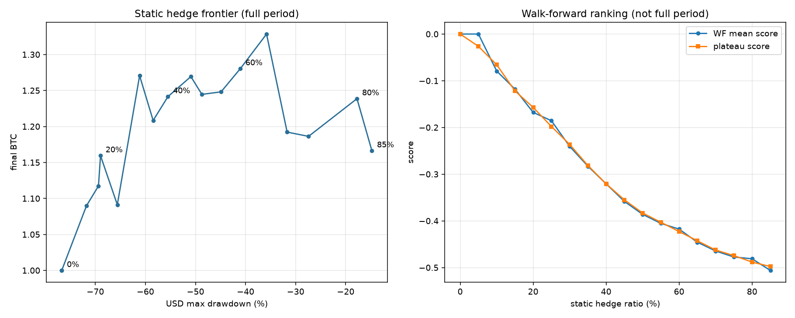

# 전략 V3 연구 — 정적 헤지 비율 (유일하게 남은 파라미터)

연구 스크립트: `scripts/static_ratio_frontier.py` → 결과 `reports/v3_static_ratio/`
데이터: `data/raw_new` (8h 마크가격 포함 스냅샷, 2020-08-11 ~ 2026-09-01)

> **결론 먼저**: **최적 비율은 이 데이터에 존재하지 않는다.** 사전 등록한 판정 통계는 격자 경계(0%)를 가리켰고 — 내가 정한 규칙에 따라 이는 **판정 불가**다. 프론티어는 거의 선형이며 인접 5%p 간 잡음이 전체 폭보다 크다. 즉 정적 비율은 **최적화 결과가 아니라 위험 선호의 선택**이다. 그리고 강건성 검사를 모두 통과하는 구간은 **10~20%** 인데, 거기서는 낙폭 감소 효과가 작다. **이 데이터로는 "큰 낙폭 감소"를 검증된 형태로 제공할 수 없다.**

---

## 1. 왜 이 연구를 했나

V2 가 동적 레짐 분류기를 기각했다(`docs/strategy_v2.md` §6.1). 그러면 자유 파라미터가 **정적 비율 하나만** 남는데, 그 파라미터는 **한 번도 탐색된 적이 없었다.** `reports/research_v1/` 의 72조합 그리드는 *레짐* 파라미터(bull/neutral/bear)를 훑은 것이고, `fixed_50` 은 벤치마크로 끼워넣은 값일 뿐이다. **50 이라는 숫자에는 근거가 없었다.**

## 2. 사전 등록한 설계 (결과를 보기 전에 고정)

| 항목 | 내용 |
|---|---|
| 격자 | 비율 ∈ {0.00, 0.05, …, 0.85}, 18점. 0.85 는 하드 리스크 캡 |
| **판정 통계** | **워크포워드 테스트 폴드의 `score_run` 평균.** 전체 기간 성적은 판정에 쓰지 않는다 |
| 평지 규칙 | 각 비율을 자신 ±5%p 이웃과의 평균으로 재채점. 뾰족한 봉우리는 넓은 평지에 진다 |
| **경계 규칙** | 승자가 격자 경계(0.00 또는 0.85)면 **승자가 아니라 "판정 불가"** 로 보고한다 |
| 산출물 | 단일 숫자가 아니라 **프론티어**(BTC 수량 vs USD 최대낙폭). 프론티어가 평평하면 "이건 최적화가 아니라 위험 선호"라고 그대로 쓴다 |
| 강건성 | 사전 등록 분할 + 시작일 의존성(2년 보유, 91일 간격) + 역펀딩(−1bp/−3bp) |

## 3. 판정 통계 결과 — 그리고 내 설계 오류

`score_run` 평균은 비율이 올라갈수록 **단조 감소**했다. 최고점은 0.00.

| 비율 | 0.00 | 0.20 | 0.50 | 0.65 | 0.85 |
|---|---:|---:|---:|---:|---:|
| WF 평균 점수 | **0.000** | −0.168 | −0.386 | −0.446 | −0.506 |
| WF 평균 최종 BTC | 1.000 | 0.985 | 0.954 | 0.945 | **0.936** |
| BTC 증가 폴드 | — | 2/7 | 2/7 | 2/7 | 2/7 |
| **Wilson 95% CI** | — | [0.082, 0.641] | [0.082, 0.641] | [0.082, 0.641] | [0.082, 0.641] |

> **⚠️ 폴드 승률 열은 증거가 아니다 (2026-09-02 추가)**: 전 비율의 Wilson 95% 구간이 [0.082, 0.641] 로 **동일하고 모두 0.5를 포함한다.** "2/7"은 "나쁘다"가 아니라 **"n=7 로는 알 수 없다"** 로 읽어야 한다. 이 열은 아래 §7 판정의 근거로 쓰이지 않는다.

**승자가 격자 경계(0.00)다 → 경계 규칙에 의해 판정 불가.**

> **⚠️ 설계 오류 자백**: `score_run` = 0.5·CAGR_BTC + 0.5·(CAGR_USD − HODL) − 0.25·max(0, MDD_HODL − MDD) 인데, 마지막 페널티 항은 **전략 낙폭이 HODL보다 나쁠 때만** 작동한다. 즉 **HODL보다 낙폭을 줄인 것에는 점수를 하나도 주지 않는다.** 그런데 낙폭 축소는 이 전략의 주된 목적이다. 나는 이 목적함수를 사전 등록할 때 이 부정합을 잡았어야 했다. 잡지 못했다.
>
> 그렇다고 결과를 본 뒤에 목적함수를 갈아끼우면 그건 되돌려 맞추기다. 그래서 **사전 등록 결과는 위와 같이 그대로 보고하고**, 아래부터는 목적함수와 무관한 **프론티어**로 판단한다(규칙 4).

또 하나: 워크포워드 폴드 평균에서 **모든 헤지 비율이 BTC를 잃었다**(0.993 → 0.936). 전체 기간에서는 0.10 이상 모든 비율이 BTC를 늘렸는데도 그렇다. 이 모순이 이 연구의 핵심이다(§5).

## 4. 프론티어 — 최적점이 없다

| 비율 | 최종 BTC | USD CAGR | USD 최대낙폭 | 펀딩(BTC) | 거래 |
|---|---:|---:|---:|---:|---:|
| 0% (HODL) | 1.000 | +6.4% | −76.7% | 0 | 0 |
| 20% | 1.159 | +9.4% | −69.0% | 0.071 | 5 |
| **25%** | **1.091** | +8.1% | −65.6% | 0.091 | 4 |
| **30%** | **1.271** | +11.2% | −61.2% | 0.137 | 10 |
| 50% | 1.245 | +10.8% | −48.7% | 0.245 | 11 |
| 65% | **1.328** | +12.1% | −35.8% | 0.332 | 14 |
| 85% | 1.166 | +9.5% | **−14.8%** | 0.438 | 8 |

**인접한 5%p 사이의 진동(25% → 30% 에서 BTC 1.091 → 1.271, +0.18)이 전체 스프레드(1.09~1.33, 0.24)와 맞먹는다.** 이건 신호가 아니라 잡음이다. 0.65 의 최고점 1.328 은 평지가 아니라 봉우리이므로 채택 대상이 아니다.

**비용/편익은 사실상 선형이다.** 워크포워드 폴드(180일) 평균으로 보면:

| 비율 | 폴드당 BTC 손실 | HODL 대비 낙폭 감소 | 낙폭 1%p당 BTC 비용 |
|---|---:|---:|---:|
| 10% | −0.70% | 2.1%p | 0.33% |
| 50% | −4.59% | 12.0%p | 0.38% |
| 85% | −6.45% | 20.3%p | 0.32% |

**어느 비율에서도 낙폭 1%p 당 약 0.33%(180일)의 BTC를 낸다.** 싸게 사는 구간이 없다 = **최적화할 대상이 없다.** 이건 순수한 다이얼이다.

## 5. 전체 기간과 워크포워드가 모순되는 이유 — 이건 보험이다

비율 85% 의 폴드별 결과를 보면 정체가 드러난다.

| 폴드 | 최종 BTC | 해당 구간 HODL USD CAGR |
|---|---:|---:|
| 0 | 0.897 | +63.6% |
| **1** | **0.485** | **+625.7%** |
| 2 | 1.142 | −26.0% |
| 3 | 0.767 | +108.4% |
| 4 | 0.838 | +75.7% |
| **5** | **1.532** | **−63.9%** |
| 6 | 0.888 | +34.8% |

**7폴드 중 2폴드에서만 이익이 났고, 그 2폴드는 정확히 하락장이다.** 그리고 폴드 1(HODL +626% 폭등장)에서는 **BTC의 51.5%를 잃었다.**

분할 구간에서도 같은 구조가 단조롭게 나타난다.

| 비율 | validation (상승장) | out_of_sample (하락장) |
|---|---:|---:|
| 0% | 1.000 | 1.000 |
| 20% | 0.919 | 1.146 |
| 50% | 0.780 | 1.299 |
| 85% | **0.633** | **1.475** |

**상승장에서는 비율이 오를수록 단조 손실, 하락장에서는 단조 이익.** 이것이 엣지가 아니라 **국면에 대한 방향성 베팅**이라는 정의 그 자체다.

정직한 서술: **이 전략은 알파가 아니라 보험이다.** 대부분의 기간에 보험료를 내고, 폭락이 오면 지급받는다. 그리고 이 표본에는 **폭락이 한 번(2022) 있었다.** 청구 사건이 한 번뿐인 데이터로 보험의 기대가치를 통계적으로 검증할 수는 없다.

## 6. 강건성 — 높은 비율은 살아남지 못한다

### 6.1 역펀딩 (유일하게 FAIL을 만드는 시나리오)

| 비율 | 기준 | −1bp/8h | −3bp/8h |
|---|---|---|---|
| 10~20% | PASS | **PASS** | FAIL |
| 30~35% | PASS | **PASS** | FAIL |
| 25%, 40% 이상 | PASS | **FAIL** | FAIL |

**−1bp 역펀딩에서 살아남는 건 대략 10~35% 구간뿐이고, 40% 이상은 전부 FAIL 이다.** −3bp 에서는 전 구간 FAIL — 이 부분은 V2 의 펀딩 가드로도 해결되지 않았다.

### 6.2 시작일 의존성 (2년 보유, 14개 창)

| 비율 | BTC 증가한 창 | **Wilson 95% CI** | **최악 창의 최종 BTC** |
|---|---:|---:|---:|
| 10% | 7/14 = 50.0% | [0.268, 0.732] | 0.925 |
| **15%** | 8/14 = **57.1%** | [0.326, 0.786] | 0.858 |
| 20% | 6/14 = 42.9% | [0.214, 0.674] | 0.794 |
| 50% | 6/14 = 42.9% | [0.214, 0.674] | 0.499 |
| 85% | 6/14 = 42.9% | [0.214, 0.674] | **0.284** |

승률 쪽은 **n=14 로도 여전히 판정 불가**다 — 전 비율의 구간이 0.5를 포함하므로 "15%가 57.1%로 최고"라는 관찰은 근거가 되지 않는다(이전 판에서 이를 근거처럼 인용했으나 철회한다). 또한 14개 창은 서로 91일 간격으로 겹쳐 있어 독립 표본이 아니므로, 이 구간조차 실제보다 좁게 나온다.

반면 **최악 창 수치는 승률과 달리 단일 관측값이라 신뢰구간 문제가 없고, 그대로 유효하다**: 비율에 따라 단조 악화되어 85%에서는 **BTC의 71.6%를 잃는다.** §7·§8의 판정은 이쪽에 근거한다.

## 7. 판정

| 질문 | 답 |
|---|---|
| 최적 정적 비율이 존재하는가? | **아니오.** 판정 통계는 경계를 가리켜 판정 불가, 프론티어는 선형, 인접 격자 잡음이 전체 스프레드와 맞먹음 |
| 50%에 근거가 있는가? | **없다.** 다만 다른 어떤 값에도 근거가 없다 — 50%가 특별히 나쁘지도 않다 |
| 비율 선택은 무엇인가? | **위험 선호의 선택.** 낙폭 1%p 당 약 0.33%(180일)의 BTC를 내는 균일한 가격표 |
| 모든 강건성 검사를 통과하는 구간은? | **10~20%** (역펀딩 −1bp 생존, 최악 2년 창 0.79~0.93) |
| 그 구간에서 목적을 달성하는가? | **거의 못 한다.** 낙폭 −76.7% → −69~72%. 원하던 "낙폭 대폭 축소"가 아니다 |
| 높은 비율(50~85%)을 쓰면? | 낙폭은 −49~−15%로 크게 줄지만, 상승장에서 BTC 22~37% 손실, 최악 2년 창 −50~−72%, 역펀딩 −1bp 에서 FAIL |

**핵심 결론: 이 데이터로는 "큰 낙폭 감소"와 "검증된 강건성"을 동시에 얻을 수 없다.** 둘 중 하나를 명시적으로 포기해야 하며, 그 선택은 연구가 대신해줄 수 없다.

## 8. 운영 권고

1. **Shadow 기본값을 `fixed_hedge` 20% 로 설정했다**(`configs/shadow.yaml`). 이유는 성과가 좋아서가 아니라 **모든 강건성 검사를 통과하는 유일한 구간이기 때문**이며, 이는 최적화 결과가 아니라 보수적 기본값이다. 위험 선호가 다르면 `strategy.fixed_hedge.ratio` 한 줄로 바꾼다.
2. **비율을 올리기 전에 반드시 §6.2 최악 창 수치를 확인할 것.** 85%는 2년 안에 BTC 71.6%를 잃은 창이 실제로 존재한다.
3. **실현 펀딩을 상시 감시할 것.** 40% 이상 비율은 −1bp/8h 역펀딩이 지속되면 실패한다. 이 조건이 관측되면 V2 펀딩 가드를 켜거나(−1bp까지만 방어) 비율을 낮춘다.
4. **전체 기간 성적(1.25~1.33)을 근거로 비율을 정하지 말 것.** 그 숫자는 2022년 폭락 한 번에 의존한다.

## 9. 남은 한계

* 표본에 대규모 폭락이 **한 번**뿐이다. 보험형 전략의 기대가치는 이 데이터로 검증 불가능하다.
* 사전 등록한 목적함수 `score_run` 이 낙폭 축소를 평가하지 못한다(§3). 향후 연구에서는 목적함수를 먼저 고쳐 사전 등록해야 하며, **이번 결과를 근거로 목적함수를 고르면 안 된다.**
* 워크포워드 폴드는 180일로 짧아 폭락 국면을 포함하는 폴드가 2개뿐이다.
* §8 미검증 항목(실거래소 접속, 펀딩 공식 실측, 수수료율)은 그대로 남아 있다 — `docs/requirements_audit.md`.

**수익을 보장하지 않는다.** 이 연구의 결론은 "최적 비율을 찾았다"가 아니라 **"찾을 수 있는 최적 비율이 없다는 것을 확인했다"** 이다.
