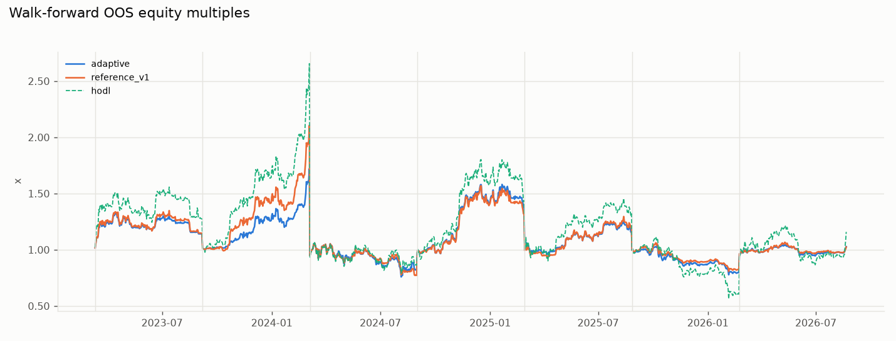
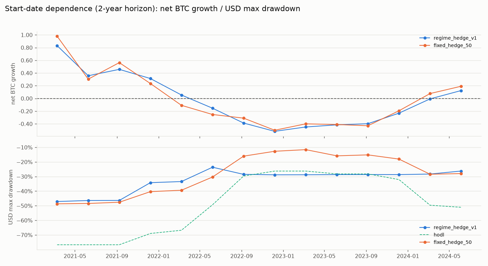

# Overfitting validation report (Split / Grid / Walk-forward / start-date dependence)

- run: `research-20260902T065605Z-4f4dd4af` / git `30eb99387c6dffe5975144aa819553f971aaa4a0` / config `4f4dd4af078e` / seed 42
- Chronological split: research 2021-03-10→2024-06-22 / validation 2024-06-23→2025-07-27 / OOS 2025-07-28→2026-09-01
- Principles: no random shuffling; parameters are selected on the research/training windows only; no going back to revise parameters after seeing the OOS results (any change made after this report invalidates the OOS).

## 1. Research-segment Grid Search (72 combinations, top 10 by plateau score)

Objective: Composite objective (documented in docs/backtest_methodology.md): 0.5 · CAGR_BTC + 0.5 · (CAGR_USD − HODL_CAGR_USD) − 0.25 · max(0, MDD_HODL_USD − MDD_USD) i.e. reward BTC growth and USD performance relative to HODL equally, penalise a USD drawdown worse than HODL. NaNs score −inf.

| hedge_bull | hedge_neutral | hedge_bear | regime_confirm_bars | slope_lookback | score | neighbour_score | plateau_score | final_btc | cagr_usd | excess_vs_hodl_usd_pct | max_drawdown_usd | total_trades |
|---|---|---|---|---|---|---|---|---|---|---|---|---|
| 0.10 | 0.60 | 0.85 | 5 | 10 | 0.1491 | 0.0923 | 0.1207 | 1.5633 | 0.2011 | 0.5633 | -0.4118 | 107 |
| 0.10 | 0.60 | 0.70 | 5 | 10 | 0.1257 | 0.0889 | 0.1073 | 1.4632 | 0.1772 | 0.4632 | -0.4424 | 87 |
| 0.20 | 0.60 | 0.85 | 5 | 10 | 0.1137 | 0.0887 | 0.1012 | 1.4137 | 0.1649 | 0.4137 | -0.3965 | 87 |
| 0.20 | 0.60 | 0.70 | 5 | 10 | 0.1202 | 0.0752 | 0.0977 | 1.4405 | 0.1716 | 0.4405 | -0.4260 | 84 |
| 0.10 | 0.45 | 0.85 | 5 | 10 | 0.0993 | 0.0734 | 0.0863 | 1.3555 | 0.1501 | 0.3555 | -0.4787 | 105 |
| 0.10 | 0.60 | 0.85 | 5 | 5 | 0.0827 | 0.0818 | 0.0823 | 1.2910 | 0.1332 | 0.2910 | -0.4322 | 113 |
| 0.10 | 0.60 | 0.85 | 10 | 10 | 0.0768 | 0.0839 | 0.0803 | 1.2682 | 0.1271 | 0.2682 | -0.4192 | 82 |
| 0.10 | 0.60 | 0.85 | 10 | 5 | 0.0811 | 0.0697 | 0.0754 | 1.2848 | 0.1315 | 0.2848 | -0.4837 | 82 |
| 0.10 | 0.60 | 0.70 | 5 | 5 | 0.0733 | 0.0771 | 0.0752 | 1.2552 | 0.1236 | 0.2552 | -0.4661 | 108 |
| 0.10 | 0.45 | 0.70 | 5 | 10 | 0.0809 | 0.0687 | 0.0748 | 1.2840 | 0.1313 | 0.2840 | -0.5054 | 81 |

- Research-segment rank of the reference V1 (0.10/0.45/0.85, 2-day confirmation, 5-day slope): 29 / 72 (plateau score 0.0568)

## 2. Performance by segment (research / validation / OOS)

| Segment | Strategy | Final BTC | BTC CAGR | USD CAGR | HODL USD CAGR | USD vs HODL | USD MDD | HODL MDD | Trades | Funding | Verdict |
|---|---|---|---|---|---|---|---|---|---|---|---|
| research | regime_hedge_v1 | 1.2164 | +6.14% | +11.29% | +4.85% | +21.64% | -47.12% | -76.71% | 151 | 0.0774 | PASS |
| research | hodl | 1.0000 | +0.00% | +4.85% | +4.85% | +0.00% | -76.71% | -76.71% | 0 | 0.0000 | BENCHMARK |
| research | fixed_hedge_50 | 1.2655 | +7.42% | +12.64% | +4.85% | +26.55% | -48.68% | -76.71% | 10 | 0.1793 | PASS |
| research | fixed_hedge_100 | 1.2302 | +6.50% | +11.67% | +4.85% | +23.02% | -4.28% | -76.71% | 8 | 0.4094 | PASS |
| research | ema200_simple | 1.2292 | +6.48% | +11.64% | +4.85% | +22.92% | -50.56% | -76.71% | 83 | 0.0200 | PASS |
| research | regime_hedge_research_best | 1.5633 | +14.55% | +20.11% | +4.85% | +56.33% | -41.18% | -76.71% | 107 | 0.1096 | PASS |
| validation | regime_hedge_v1 | 0.7261 | -25.34% | +31.58% | +76.24% | -27.39% | -22.18% | -28.20% | 56 | 0.0148 | FAIL |
| validation | hodl | 1.0000 | +0.00% | +76.24% | +76.24% | +0.00% | -28.20% | -28.20% | 0 | 0.0000 | BENCHMARK |
| validation | fixed_hedge_50 | 0.7804 | -20.26% | +40.54% | +76.24% | -21.96% | -14.40% | -28.20% | 4 | 0.0312 | FAIL |
| validation | fixed_hedge_100 | 0.5723 | -39.93% | +5.88% | +76.24% | -42.77% | -4.09% | -28.20% | 5 | 0.0537 | FAIL |
| validation | ema200_simple | 0.6806 | -29.63% | +24.03% | +76.24% | -31.94% | -29.83% | -28.20% | 64 | 0.0035 | FAIL |
| validation | regime_hedge_research_best | 0.8211 | -16.47% | +47.21% | +76.24% | -17.89% | -18.65% | -28.20% | 32 | 0.0177 | FAIL |
| out_of_sample | regime_hedge_v1 | 1.2372 | +21.39% | -18.27% | -32.67% | +23.72% | -26.71% | -53.06% | 38 | 0.0319 | PASS |
| out_of_sample | hodl | 1.0000 | +0.00% | -32.67% | -32.67% | +0.00% | -53.06% | -53.06% | 0 | 0.0000 | BENCHMARK |
| out_of_sample | fixed_hedge_50 | 1.2990 | +26.90% | -14.56% | -32.67% | +29.90% | -28.45% | -53.06% | 4 | 0.0302 | PASS |
| out_of_sample | fixed_hedge_100 | 1.5869 | +52.29% | +2.53% | -32.67% | +58.69% | -1.42% | -53.06% | 5 | 0.0658 | PASS |
| out_of_sample | ema200_simple | 1.2815 | +25.35% | -15.60% | -32.67% | +28.15% | -25.67% | -53.06% | 18 | 0.0316 | PASS |
| out_of_sample | regime_hedge_research_best | 1.2673 | +24.09% | -16.46% | -32.67% | +26.73% | -24.22% | -53.06% | 30 | 0.0351 | PASS |

## 3. Nested Walk-forward (train 730 days → test 180 days, stepping forward 180 days)

| Fold | Test window | Selected parameters (bull/neutral/bear/confirm/slope) | Train score | Test score (adaptive) | Test score (fixed V1) |
|---|---|---|---|---|---|
| 0 | 2023-03-11→2023-09-06 | 0.20/0.60/0.85/2/5 | 0.3396 | -0.2652 | -0.2532 |
| 1 | 2023-09-07→2024-03-04 | 0.20/0.60/0.85/10/10 | 0.3044 | -2.4184 | -1.5488 |
| 2 | 2024-03-05→2024-08-31 | 0.10/0.60/0.85/10/5 | 0.0908 | -0.0914 | -0.1772 |
| 3 | 2024-09-01→2025-02-27 | 0.10/0.60/0.70/5/10 | -0.1889 | -0.1080 | -0.2339 |
| 4 | 2025-02-28→2025-08-26 | 0.10/0.45/0.70/5/10 | -0.1678 | -0.2952 | -0.2291 |
| 5 | 2025-08-27→2026-02-22 | 0.10/0.60/0.70/5/10 | -0.2274 | 0.5068 | 0.5910 |
| 6 | 2026-02-23→2026-08-21 | 0.20/0.60/0.70/5/10 | 0.0774 | -0.2535 | -0.2604 |

| Fold | Strategy | Final BTC | USD vs HODL | USD MDD | HODL MDD | Trades | Verdict |
|---|---|---|---|---|---|---|---|
| 0 | adaptive | 0.8952 | -10.48% | -13.79% | -18.19% | 28 | FAIL |
| 0 | reference_v1 | 0.9002 | -9.98% | -14.91% | -18.19% | 30 | FAIL |
| 0 | hodl | 1.0000 | +0.00% | -18.19% | -18.19% | 0 | BENCHMARK |
| 0 | fixed_hedge_50 | 0.9121 | -8.79% | -10.45% | -18.19% | 3 | FAIL |
| 1 | adaptive | 0.6477 | -35.23% | -12.13% | -15.93% | 13 | FAIL |
| 1 | reference_v1 | 0.7932 | -20.68% | -13.28% | -15.93% | 22 | FAIL |
| 1 | hodl | 1.0000 | +0.00% | -15.93% | -15.93% | 0 | BENCHMARK |
| 1 | fixed_hedge_50 | 0.6645 | -33.55% | -8.68% | -15.93% | 5 | FAIL |
| 2 | adaptive | 0.9500 | -5.00% | -28.33% | -26.17% | 20 | FAIL |
| 2 | reference_v1 | 0.8953 | -10.47% | -27.06% | -26.17% | 37 | FAIL |
| 2 | hodl | 1.0000 | +0.00% | -26.17% | -26.17% | 0 | BENCHMARK |
| 2 | fixed_hedge_50 | 1.0888 | +8.88% | -12.06% | -26.17% | 3 | PASS |
| 3 | adaptive | 0.9649 | -3.51% | -12.58% | -20.77% | 12 | FAIL |
| 3 | reference_v1 | 0.9221 | -7.79% | -15.82% | -20.77% | 17 | FAIL |
| 3 | hodl | 1.0000 | +0.00% | -20.77% | -20.77% | 0 | BENCHMARK |
| 3 | fixed_hedge_50 | 0.8651 | -13.49% | -11.19% | -20.77% | 4 | FAIL |
| 4 | adaptive | 0.8880 | -11.20% | -10.40% | -19.11% | 10 | FAIL |
| 4 | reference_v1 | 0.9143 | -8.57% | -10.83% | -19.11% | 28 | FAIL |
| 4 | hodl | 1.0000 | +0.00% | -19.11% | -19.11% | 0 | BENCHMARK |
| 4 | fixed_hedge_50 | 0.8878 | -11.22% | -9.86% | -19.11% | 3 | FAIL |
| 5 | adaptive | 1.3157 | +31.57% | -24.43% | -49.65% | 20 | PASS |
| 5 | reference_v1 | 1.3609 | +36.09% | -24.02% | -49.65% | 25 | PASS |
| 5 | hodl | 1.0000 | +0.00% | -49.65% | -49.65% | 0 | BENCHMARK |
| 5 | fixed_hedge_50 | 1.3280 | +32.80% | -26.77% | -49.65% | 4 | PASS |
| 6 | adaptive | 0.8870 | -11.30% | -9.50% | -28.80% | 7 | FAIL |
| 6 | reference_v1 | 0.8837 | -11.63% | -9.49% | -28.80% | 14 | FAIL |
| 6 | hodl | 1.0000 | +0.00% | -28.80% | -28.80% | 0 | BENCHMARK |
| 6 | fixed_hedge_50 | 0.9324 | -6.76% | -15.51% | -28.80% | 3 | FAIL |

- Chained folds (each fold restarts at 1 BTC, compounded) BTC growth: adaptive -44.92% / fixed V1 -35.18%
- Chained-fold USD growth: adaptive +113.48% / fixed V1 +151.22% / HODL +287.58%
- adaptive: folds with BTC growth 1/7, folds beating HODL (USD) 1/7, mean USD vs HODL -6.45%, mean BTC growth -0.0645
- reference_v1: folds with BTC growth 1/7, folds beating HODL (USD) 1/7, mean USD vs HODL -4.72%, mean BTC growth -0.0472
- fixed_hedge_50: folds with BTC growth 2/7, folds beating HODL (USD) 2/7, mean USD vs HODL -4.59%, mean BTC growth -0.0459

## 4. Start-date dependence (2-year holds, start dates 91 days apart)

- regime_hedge_v1: of 14 start dates, BTC grew in 6 and HODL (USD) was beaten in 6; median BTC growth -0.0804 (min -0.5176, max +0.8302); median USD vs HODL -8.04% (min -51.76%, max +83.02%)
- fixed_hedge_50: of 14 start dates, BTC grew in 6 and HODL (USD) was beaten in 6; median BTC growth -0.1513 (min -0.5005, max +0.9788); median USD vs HODL -15.13% (min -50.05%, max +97.88%)

## 5. Interpretation guidelines

- If the adaptive parameters are not consistently better than the fixed V1 out of sample, the grid search only adds overfitting risk → keep the fixed parameters.
- If BTC shrinks or the strategy trails HODL (USD) in half or more of the folds, the strategy is taken to have no timing alpha (only the funding carry remains).
- If the sign of the result flips depending on the start date, the performance depends on a specific period (e.g. the 2022 bear market).