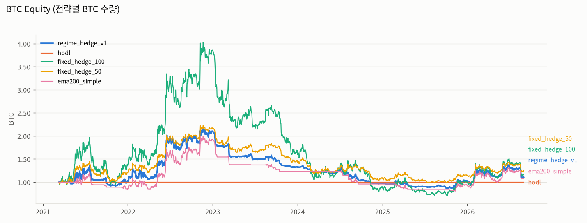
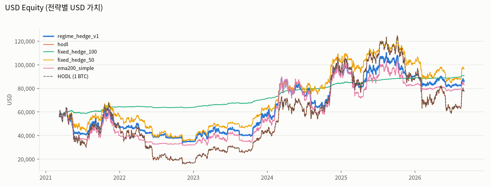
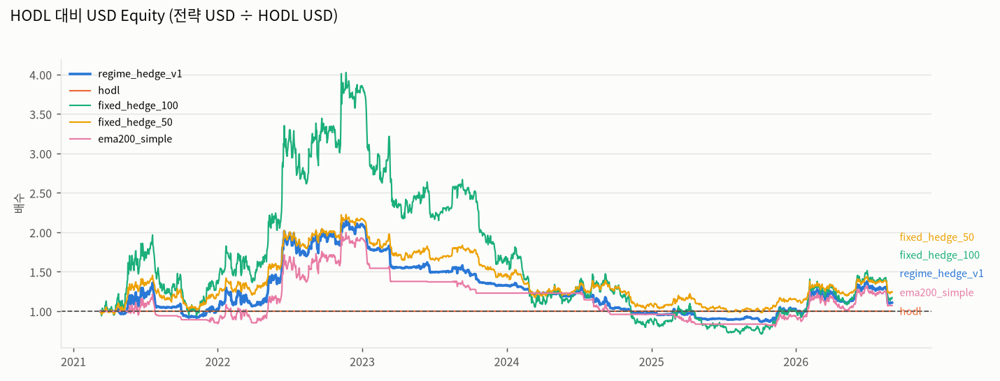
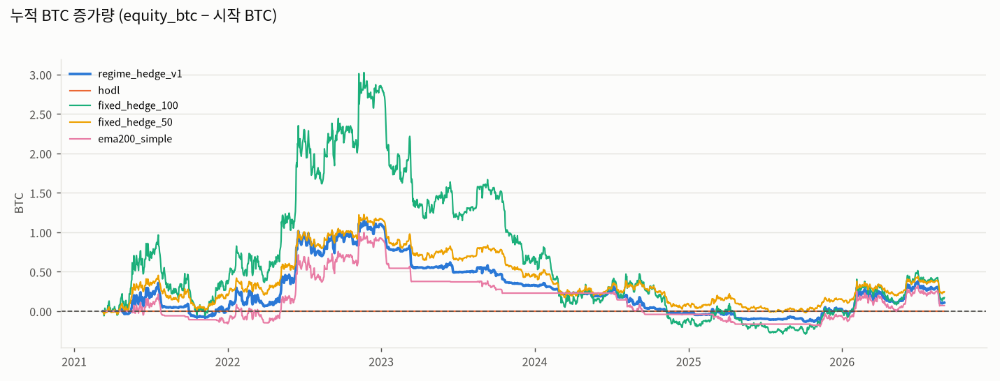
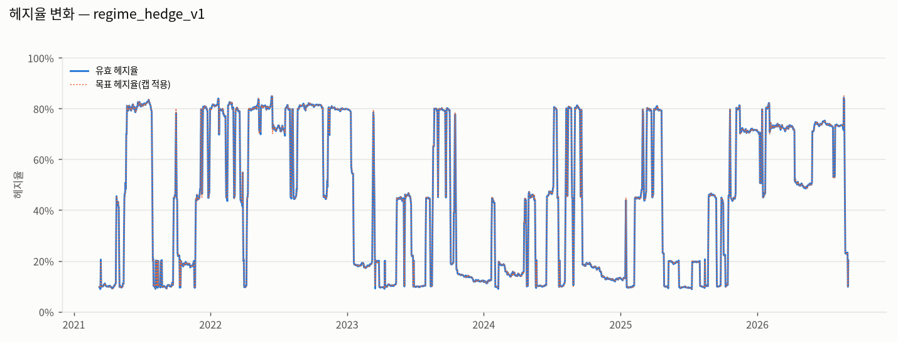
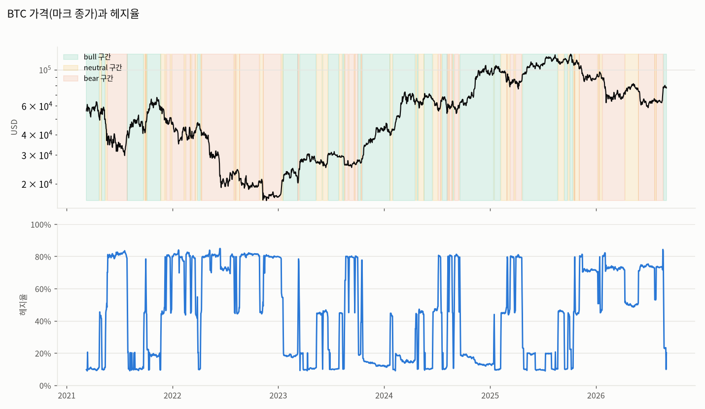
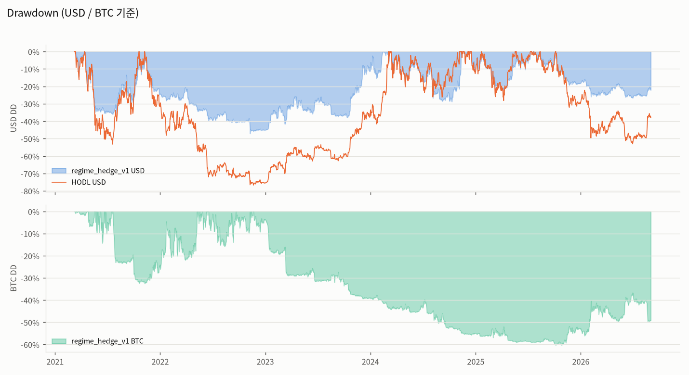
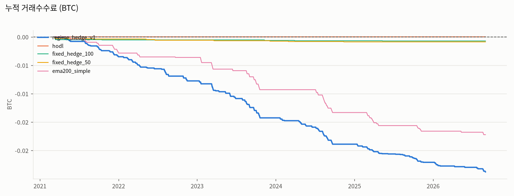
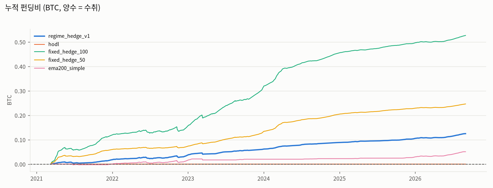

# 백테스트 보고서 — regime_hedge_v1

- 실행 ID: `v1_reference-20260902T065112Z-4f4dd4af` / 실행 시각(UTC): 2026-09-02T06:51:12.542944+00:00
- 코드 버전: 0.1.0 / git: `63836543a3e661b343e32118cb53cb1b052d13e8` / 설정 해시: `4f4dd4af078ebf06cd365f5e3400f866d1d3584ff2bb0a3d83da5fd68ac266df` / seed: 42
- 기간: 2021-03-10 → 2026-09-01 (2002일, 5.48년) / 시작 BTC: 1.0

## 1. 핵심 결과 (BTC 기준과 USD 기준을 동시에 평가)

| 지표 | 값 |
|---|---|
| 최종 BTC | 1.1085 |
| 순 BTC 증가량 | 0.1085 |
| BTC 기준 CAGR | +1.90% |
| 시작 USD | 54,956 |
| 최종 USD | 85,759 |
| USD 기준 CAGR | +8.46% |
| HODL 최종 USD | 77,368 |
| HODL 대비 USD 초과성과 | +10.85% |
| USD 최대 낙폭 | -47.12% |
| HODL USD 최대 낙폭 | -76.71% |
| BTC 최대 낙폭 | -60.30% |
| USD Sharpe(일간, rf=0) | 0.41 |
| 총 실현 손익(BTC) | 0.0049 |
| 총 미실현 손익(BTC) | 0.0027 |
| 총 펀딩비(BTC, +수취) | 0.1246 |
| 총 거래수수료(BTC) | -0.0238 |
| 총 슬리피지 비용(BTC) | 0.0238 |
| 총 거래 횟수 | 243 |
| 총 회전율(명목/평균자산) | 37.39 |
| 평균 헤지율 | +44.22% |
| 최대 헤지율 | +84.90% |
| 최악 연속 손실일(USD) | 8 |
| 최악 연속 손실 구간 수익률(USD) | -15.76% |
| 최악 연속 손실 청산거래 수 | 18 |
| 판정 | PASS |

### BTC 손익 분해 (최종 BTC − 시작 BTC = 실현 + 미실현 + 펀딩 + 수수료)

| 항목 | BTC |
|---|---|
| 헤지 타이밍 손익(실현+미실현, 수수료 전) | +0.0076 |
| 펀딩비 수취(+)/지급(−) | +0.1246 |
| 거래수수료 | -0.0238 |
| 슬리피지(체결가에 이미 반영, 참고) | -0.0238 |
| 순 BTC 증가량 | +0.1085 |

판정 기준: BTC 수량이 늘지 않았거나, USD 가치가 HODL 대비 30% 이상 열위이거나, USD 낙폭이 HODL보다 나쁘면 FAIL; USD가 HODL 대비 10% 이상 열위면 WEAK; 그 외 PASS. BTC만 늘고 USD가 크게 줄면 실패로 본다.

## 2. 비교 기준 전략

| 전략 | 최종 BTC | BTC CAGR | 최종 USD | USD CAGR | HODL 대비 USD | USD MDD | BTC MDD | 펀딩(BTC) | 수수료(BTC) | 슬리피지(BTC) | 거래 | 평균 헤지율 | 판정 |
|---|---|---|---|---|---|---|---|---|---|---|---|---|---|
| regime_hedge_v1 | 1.1085 | +1.90% | 85,759 | +8.46% | +10.85% | -47.12% | -60.30% | 0.1246 | -0.0238 | 0.0238 | 243 | +44.22% | PASS |
| hodl | 1.0000 | +0.00% | 77,368 | +6.44% | +0.00% | -76.71% | +0.00% | 0.0000 | 0.0000 | 0.0000 | 0 | +0.00% | BENCHMARK |
| fixed_hedge_100 | 1.1718 | +2.94% | 90,661 | +9.56% | +17.18% | -4.28% | -82.38% | 0.5266 | -0.0007 | 0.0007 | 9 | +96.04% | PASS |
| fixed_hedge_50 | 1.2460 | +4.09% | 96,398 | +10.80% | +24.60% | -48.68% | -55.95% | 0.2462 | -0.0009 | 0.0009 | 11 | +48.94% | PASS |
| ema200_simple | 1.0714 | +1.27% | 82,896 | +7.79% | +7.14% | -50.56% | -59.74% | 0.0507 | -0.0172 | 0.0173 | 165 | +36.22% | PASS |

## 3. 시장 상태별 성과 (동적 전략의 확정 상태 기준)

| 상태 | 일수 | 전략 USD 수익률 | 전략 BTC 수익률 | HODL USD 수익률 | 평균 헤지율 |
|---|---|---|---|---|---|
| bull | 864 | +117.48% | -9.31% | +139.81% | +14.36% |
| neutral | 377 | -40.68% | +54.30% | -61.55% | +46.18% |
| bear | 761 | +20.96% | -20.79% | +52.70% | +77.14% |

## 4. 연도별 수익률

| 연도 | 전략 USD | 전략 BTC | HODL USD |
|---|---|---|---|
| 2021 | -13.24% | +3.22% | -15.95% |
| 2022 | -27.03% | +103.91% | -64.21% |
| 2023 | +61.83% | -36.75% | +155.85% |
| 2024 | +62.80% | -26.29% | +120.86% |
| 2025 | -1.75% | +4.89% | -6.33% |
| 2026 | -4.78% | +7.70% | -11.58% |

## 5. 월별 수익률 (USD)

| 연도 | 1월 | 2월 | 3월 | 4월 | 5월 | 6월 | 7월 | 8월 | 9월 | 10월 | 11월 | 12월 |
|---|---|---|---|---|---|---|---|---|---|---|---|---|
| 2021 |  |  | +7.1% | -5.3% | -24.2% | -1.4% | +4.6% | +13.8% | -7.2% | +24.3% | -5.2% | -12.1% |
| 2022 | -2.8% | +3.6% | +1.5% | -10.0% | -2.6% | -9.5% | +4.8% | -6.2% | -0.4% | +0.9% | -8.6% | -0.4% |
| 2023 | +18.2% | +0.1% | +7.3% | +2.6% | -6.5% | +7.5% | -3.5% | -8.8% | +0.3% | +17.6% | +7.6% | +10.7% |
| 2024 | -0.8% | +36.4% | +14.5% | -13.4% | +6.7% | -4.2% | -1.2% | -15.4% | +1.8% | +9.1% | +31.3% | -2.7% |
| 2025 | +6.6% | -11.6% | -6.4% | +6.3% | +9.9% | +2.5% | +7.4% | -2.9% | +0.9% | -5.1% | -6.2% | -0.6% |
| 2026 | -3.6% | -4.5% | +0.6% | +4.1% | -1.4% | -5.6% | +1.5% | +5.9% | -1.2% |  |  |  |

## 7. 그래프

## 8. 방법론·가정·한계

- 신호: 완결된 UTC 일봉 종가. 체결: 다음 일봉 시가 × (1 ± 슬리피지), Taker 수수료. 같은 캔들 신호·체결 없음.
- 펀딩: 실제 fundingRate 이력(00/08/16 UTC). 00:00 펀딩은 당일 체결 전, 08/16시는 체결 후 정산. 2023-11 이전 마크가격은 일봉 마크 OHLC 근사.
- 평가: Mark Price 종가 기준 미실현 손익·자산. 인덱스 가격은 검증용.
- 비용: {'taker_fee_rate': '0.0005', 'maker_fee_rate': '0.0002', 'use_maker': False, 'slippage_bps': '5', 'fee_multiplier': '1', 'slippage_multiplier': '1', 'funding_adverse_bps_per_period': '0', 'signal_delay_days': 0, 'partial_fill_ratio': '1', 'partial_fill_probability': '0', 'missed_rebalance_every_n': 0, 'missed_rebalance_indices': [], 'reorder_missed_next_day': True}
- 리스크 한도: {'max_hedge_ratio': '0.85', 'min_hedge_ratio': '0.00', 'max_daily_hedge_change': '0.20', 'min_rebalance_diff': '0.10', 'allow_long': False, 'max_effective_leverage': '1.0', 'max_short_notional_to_equity': '1.0', 'max_hedge_ratio_tolerance': '0.03', 'stale_price_max_age_seconds': 120, 'stale_mark_max_age_seconds': 120, 'max_consecutive_order_rejects': 3, 'max_clock_skew_ms': 1000, 'min_margin_ratio_buffer': '0.25', 'max_unexpected_balance_diff_btc': '0.00001'}
- 계약 사양: exchangeInfo 스냅샷(계약가치 100 USD, 정수 계약). 과거 사양 변경 이력은 확인 불가 → 현재 사양 고정(한계).
- 데이터 품질: {"market": {"klines_1d": {"dataset": "klines_1d", "rows": 2213, "first_open_time": "2020-08-11T00:00:00+00:00", "last_open_time": "2026-09-01T00:00:00+00:00", "gaps": [], "duplicates": 0, "ohlc_violations": 0, "dropped_incomplete": 1, "notes": []}, "mark_price_klines_1d": {"dataset": "mark_price_klines_1d", "rows": 2213, "first_open_time": "2020-08-11T00:00:00+00:00", "last_open_time": "2026-09-01T00:00:00+00:00", "gaps": [], "duplicates": 0, "ohlc_violations": 0, "dropped_incomplete": 1, "notes": []}, "index_price_klines_1d": {"dataset": "index_price_klines_1d", "rows": 2223, "first_open_time": "2020-08-01T00:00:00+00:00", "last_open_time": "2026-09-01T00:00:00+00:00", "gaps": [], "duplicates": 0, "ohlc_violations": 0, "dropped_incomplete": 1, "notes": []}}, "funding": {"rows": 6640, "first": "2020-08-10T16:00:00+00:00", "last": "2026-09-02T00:00:00+00:00", "irregular_intervals": ["2026-06-30T00:00:00+00:00 -> 2026-06-30T16:00:00+00:00 (16.00 h)"], "rows_with_mark_price": 3107, "min_rate": "-0.00300000", "max_rate": "0.00186012"}, "notes": [], "contract_spec_source": "data/raw/exchange_info.json (serverTime=1788317330289)"}
- 펀딩 명목가치 공식(계약수×계약가치÷마크가격)은 공식 문서에서 COIN-M 전용 원문을 찾지 못해 PARTIAL 상태이며 Shadow/Testnet 실측으로 역검증 예정.
- 슬리피지·부분체결은 모델값이며 실제 체결 품질은 실거래 데이터로 재보정 필요.
